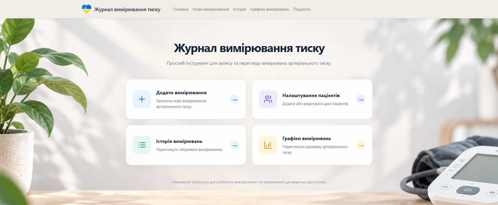
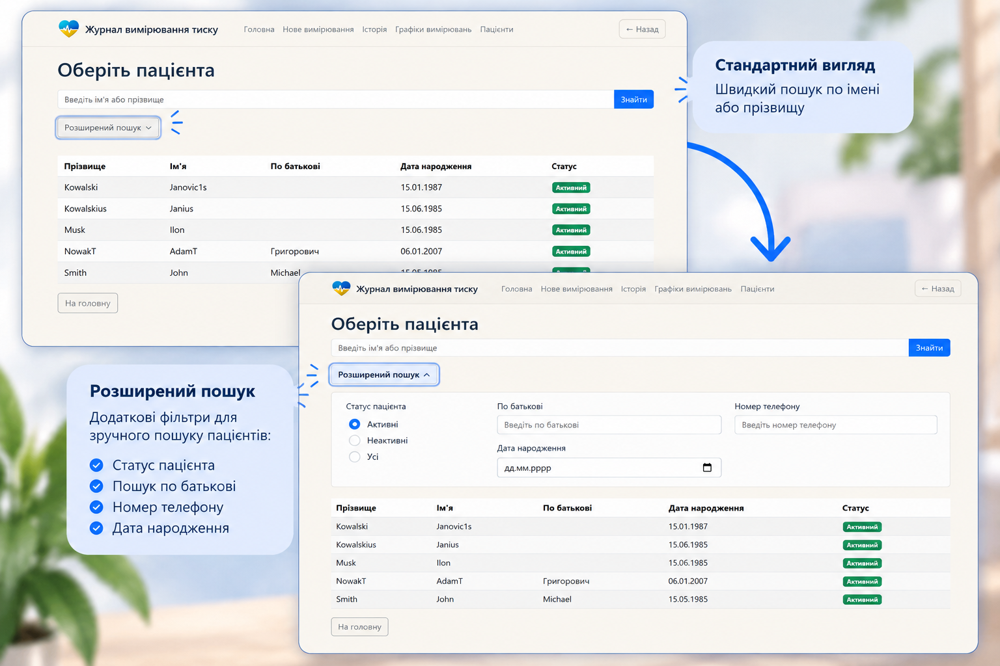
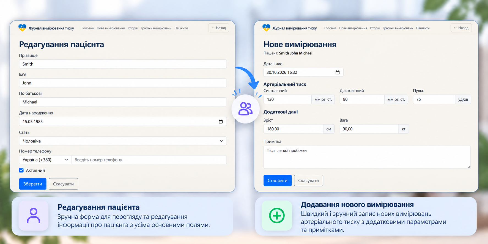
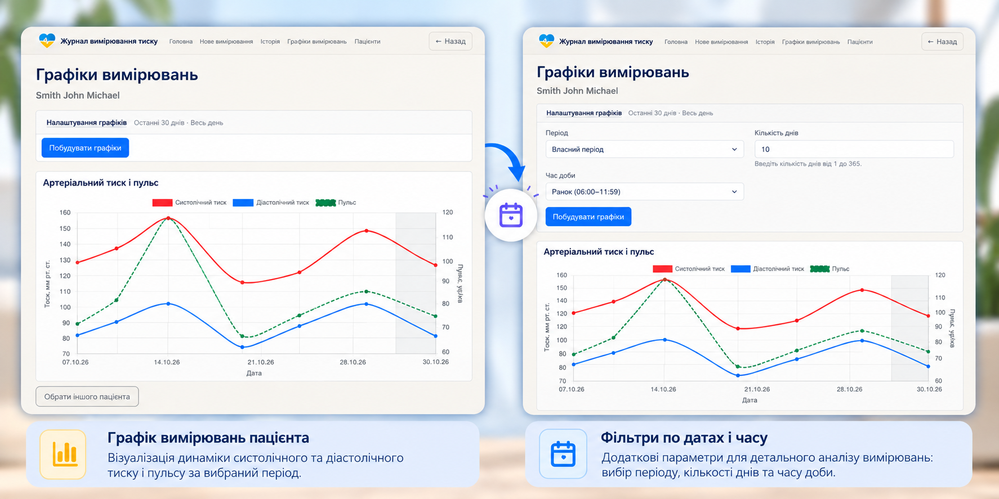

# Blood Pressure Journal

[English](#english) · [Українська](#українська)

## English

A web application for recording and visualizing blood pressure measurements for multiple people. An educational, non-commercial portfolio project.

### Features
- Manage patient profiles, including active status and optional phone number.
- Create, edit, browse, and delete blood pressure measurements.
- Record systolic and diastolic pressure, optional pulse, height, weight, and notes.
- Browse records with pagination and search/filtering.
- Explore blood pressure and pulse charts with date-range and time-of-day filters.
- Client-side form validation, including systolic pressure greater than diastolic pressure.
- Server-rendered Ukrainian-language interface and REST endpoints for patients and measurements.

### Technology
Java 21 · Spring Boot 4.1.1 · Spring MVC · Spring Data JPA / Hibernate · Thymeleaf · Bootstrap · JavaScript · Chart.js · H2 · MapStruct 1.6.3 · Maven · JUnit / Selenium.

### Project structure
- `person/` — patient domain, persistence, services, web controllers, and DTOs.
- `measurement/` — measurement domain, persistence, services, charts, controllers, and DTOs.
- `common/` — shared responses and exception handling.
- `config/` — application configuration.
- `src/main/resources/templates/` — Thymeleaf pages.
- `src/main/resources/static/` — CSS, JavaScript, and images.
- `src/test/` — unit, integration, and browser tests.

### Run locally

Build the application without running tests:

```bash
./mvnw clean package -DskipTests
```

Start the application:

```bash
./mvnw spring-boot:run
```

**Testing note:** Some Selenium browser tests require the application to be running and should be executed separately.

By default, H2 stores local data in `./data/pressuredb`.
Configuration is in `src/main/resources/application.yaml`.
Do not commit local database files.

### API
The application exposes REST endpoints under `/api/persons` and `/api/measurements`. The web interface is served separately through Thymeleaf controllers.


### Screenshots

#### Home page
Main dashboard with navigation to the application's core features.



#### Patient search
Basic and advanced patient search with additional filtering options.



#### Patient management and measurements
Editing patient information and recording new blood pressure measurements.



#### Measurement charts and filters
Visualizing blood pressure and pulse trends with configurable date ranges and time-of-day filters.




### Status and disclaimer
**Educational prototype — not production-ready.** No per-user authentication or authorization is implemented. Do not expose real patient data through an unprotected deployment.

**This application is not a certified medical device and must not be used for clinical diagnosis or treatment decisions.**

---

## Українська

Вебзастосунок для ведення журналу артеріального тиску кількох людей та перегляду динаміки показників. Навчальний некомерційний портфоліо-проєкт.

### Можливості
- Керування картками пацієнтів, зокрема статусом активності та необов’язковим телефоном.
- Створення, редагування, перегляд і видалення вимірювань.
- Збереження систолічного та діастолічного тиску, необов’язкового пульсу, зросту, ваги й приміток.
- Перегляд записів із пагінацією та пошуком/фільтрацією.
- Графіки тиску та пульсу з фільтрами періоду й часу доби.
- Клієнтська перевірка полів, зокрема правила «систолічний тиск > діастолічний».
- Україномовний вебінтерфейс на Thymeleaf та REST API для пацієнтів і вимірювань.

### Технології
Java 21 · Spring Boot 4.1.1 · Spring MVC · Spring Data JPA / Hibernate · Thymeleaf · Bootstrap · JavaScript · Chart.js · H2 · MapStruct 1.6.3 · Maven · JUnit / Selenium.

### Структура проєкту
- `person/` — модель пацієнта, збереження, сервіси, контролери та DTO.
- `measurement/` — вимірювання, збереження, сервіси, графіки, контролери та DTO.
- `common/` — спільні відповіді й обробка помилок.
- `config/` — конфігурація застосунку.
- `src/main/resources/templates/` — сторінки Thymeleaf.
- `src/main/resources/static/` — CSS, JavaScript та зображення.
- `src/test/` — модульні, інтеграційні та браузерні тести.

### Локальний запуск

Збірка застосунку без запуску тестів:

```bash
./mvnw clean package -DskipTests
```

Запуск застосунку:

```bash
./mvnw spring-boot:run
```

**Примітка щодо тестування:** Частина браузерних Selenium-тестів потребує запущеного застосунку, тому їх слід виконувати окремо.

За замовчуванням H2 зберігає локальну базу в `./data/pressuredb`.
Налаштування містяться у `src/main/resources/application.yaml`.
Не додавайте локальні файли бази даних до Git.

### API
REST-ендпоїнти доступні за шляхами `/api/persons` та `/api/measurements`. Вебінтерфейс реалізований окремими Thymeleaf-контролерами.

### Скріншоти

#### Головна сторінка
Головна сторінка з навігацією до основних функцій застосунку.


#### Пошук пацієнтів
Звичайний і розширений пошук пацієнтів із додатковими фільтрами.


#### Керування пацієнтами та вимірюваннями
Редагування даних пацієнта та додавання нових вимірювань.


#### Графіки вимірювань і фільтри
Візуалізація артеріального тиску та пульсу з фільтрами за датою і часом доби.


### Статус і застереження
**Навчальний прототип, не готовий до промислового використання.** Індивідуальна автентифікація й авторизація користувачів наразі не реалізовані. Не розміщуйте реальні дані пацієнтів у незахищеному публічному середовищі.

**Застосунок не є сертифікованим медичним виробом і не призначений для клінічної діагностики чи ухвалення рішень щодо лікування.**
